# Development Diary: Reflective Room Acoustics for 2D Games

**Tyler Crump** · COMP3180 · Session 2, 2026
Unity 6.3 LTS (6000.3.10f1) · FMOD Studio / FMOD for Unity 2.03

> **How to read this diary.** One entry per teaching week, matching the headings of the Final Project Report. Each entry records what changed, the **roadblocks** hit, the **breakthroughs** that got past them, any **plan changes** against the research proposal, and where **AI assistance** was used (cross-referenced in the report's Statement on Generative AI use). Screenshots are in [`DiaryImages/`](DiaryImages/).
>
> `[TO CONFIRM]` marks a detail I still need to check against my git history before submission. Nothing in this diary should be presented as done if it was not.

## Week dates

| Week | Dates | Focus |
|---|---|---|
| 1–7 | 27 Jul – 13 Sep | Research and early experiments |
| 8 | 14 – 20 Sep | Research proposal submitted |
| Mid-session break | 21 Sep – 4 Oct `[TO CONFIRM dates]` | |
| 9 | 5 – 11 Oct | FMOD routing for the raycast condition, system audit |
| 10 | 12 – 18 Oct | Spatialising reflections, debugging the live pipeline |
| 11 | 19 – 25 Oct | Planned: demo scenes, showcase repo, user study |
| 12 | 26 Oct – 1 Nov | Planned: study analysis, portfolio video |
| 13 | 2 – 8 Nov | Planned: final report |

---

## Up to Week 8 (27 Jul – 20 Sep): research and proposal

**Progress**
- Researched what makes game audio design effective, building a discovery document from peer-reviewed sources (Grimshaw & Schott, 2007; Jørgensen, 2008; Collins, 2009; Nacke et al., 2010; Hedges et al., 2024; Nunes & Darin, 2024) alongside FMOD's documentation.
- Tried to add reflective room audio to our 2D tilemap game with Steam Audio.
- Wrote and submitted the research proposal *Reflective Room Acoustics for 2D Games*. It has a primary research question comparing a listener-centred raycast approximation against geometry-based simulation, five learning goals (LG1–LG5), a 65-hour deliverables plan and a mixed-methods evaluation design.
- Built the first version of the `ReflectiveAudio2D` scripts: `Listener2D`, `AcousticProbe2D`, `EarlyReflections2D`, `AcousticZone2D`, `ConditionManager`, `RoomEstimationTask`, `AudioBenchmarkLogger`, `TilemapAcousticProxy`, `SurfaceType`, `OccludedEmitter2D` and `FootstepAudio`.

**Roadblock.** Steam Audio exported nothing from the scene. Its Geometry component needs a Mesh Filter or Terrain (Valve Software, 2025), and a Unity Tilemap has neither, so every later step failed silently.

**Breakthrough.** This limitation became the project's research gap. Commercial acoustic tools assume 3D meshes, so 2D tilemap games have no established route to dynamic room acoustics. The plan became three conditions:
- **A:** authored reverb zones as the baseline.
- **B:** a raycast system that measures the room around the listener.
- **C:** Steam Audio, fed by proxy geometry generated from the tilemap collider.

**Roadblock.** Where the listener should live. The initial advice was a dedicated listener object between player and camera. I questioned this, and we confirmed that putting `StudioListener` on the player is a valid, simpler setup, with one gotcha: flipping the sprite through `localScale.x` also flips the listener's left and right.

**AI use.** Claude was used to compile the research discovery document, draft the proposal against the rubric, and write the first versions of the scripts. See the Statement on Generative AI use.

`[TO CONFIRM]` Add the specific weeks for the steps above from the git log (in particular, when Steam Audio was first tried and when the scripts entered the project).

---

## Mid-session break (21 Sep – 4 Oct)

**Progress (dates `[TO CONFIRM]` from git log).** By the start of Week 9, the game's audio had been moved onto FMOD through a set of shared helpers:
- `GameAudio` for one-shots;
- `LoopingSound` for attached loops;
- `AudioManager` for VCA-driven volume channels (Master, Music, SFX, Environment, Player);
- `UIAudio` for menu sounds and the pause snapshot;
- `EraMusic` and `EraAmbience` for music and ambience driven by the game's time-era mechanic.

`[TO CONFIRM]` Anything else done over the break, or "no project work" if that's accurate.

---

## Week 9 (5 – 11 Oct): building Condition B in FMOD, and an audit

**Progress**
- **6–7 Oct.** Created the global parameters `RoomSize` and `Enclosure` (0–1) and a `Reverb Dynamic` return bus with an FMOD Reverb. Automated Reverb Time (0.4 s → 4 s), Late Delay (20 → 60 ms) and High Cut (8 → 4 kHz) against `RoomSize`, and bus volume (−40 → 0 dB) against `Enclosure`.
- **6–7 Oct.** Ran `TilemapAcousticProxy` on the level's `CompositeCollider2D`. It generated **136 vertices and 136 triangles**: wall quads extruded along Z, plus floor and ceiling caps. This is the first time Steam Audio had any geometry to work with.
- **7 Oct.** Audited every FMOD-related script in the game over two review rounds. Retired:
  - `MusicManager`, because the scenes use `EraMusic`;
  - `FootstepAudio`, which duplicated the footsteps in `PlayerAudio`;
  - the namespaced `ReflectiveAudio2D.SurfaceType`, merged into one global `SurfaceType` that holds both the FMOD surface label and `Reflectivity`;
  - `AmbienceBedSetter`, replaced by `AreaAudio`.

  The audit also logged bugs. `BoxPush` could leak its push loop when a box was destroyed. Coroutine `finally` blocks didn't run on disable, leaving state stuck in `ElementLift`, `ElementFerry`, `RotateObjectCallable` and `PlayerRespawn`. Several scripts lacked FMOD initialisation guards. `[TO CONFIRM which were fixed]`
- **8 Oct.** First full listening test of all three conditions.

**Roadblock (8 Oct): "they all sound the same."** Working through the pipeline turned up several separate causes:
1. **Two listener rigs.** `RaycastProbe` and `AudioListener` each had a `StudioListener` and an `AcousticProbe2D`. Both wrote the same global parameters, with different layer masks (`Solid` vs `Past, Present, Solid, Future`), so they overwrote each other every frame. I deleted `RaycastProbe`. 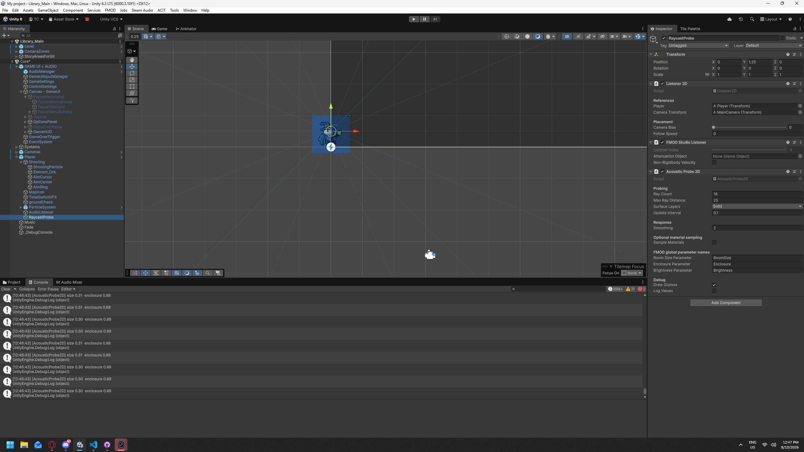
2. **Empty and static returns.** The `Reflections` and `Steam Audio Reverb` returns had no effects. In the working FMOD project, `Reverb Dynamic`'s Reverb Time was fixed at 1.5 s with no automation, so the raycast values changed nothing. `Reverb Zone` also had its Dry Level at 0 dB, doubling the direct sound. 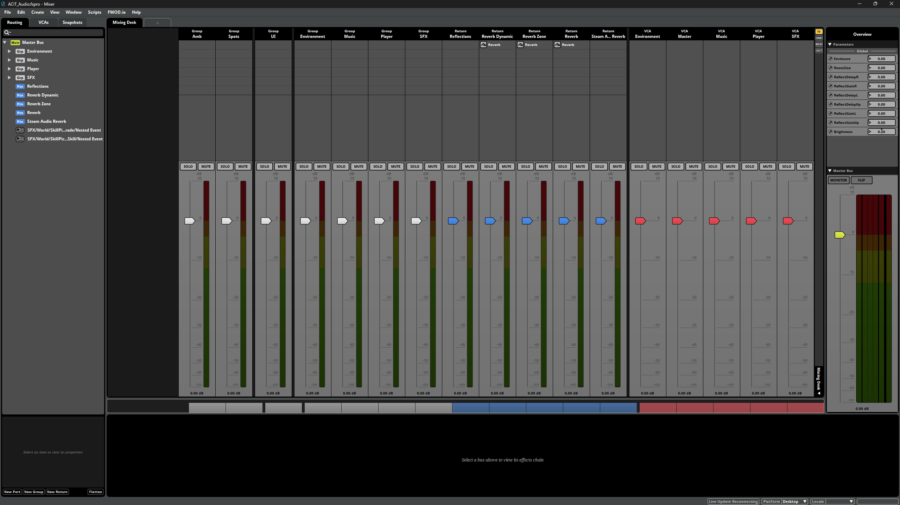 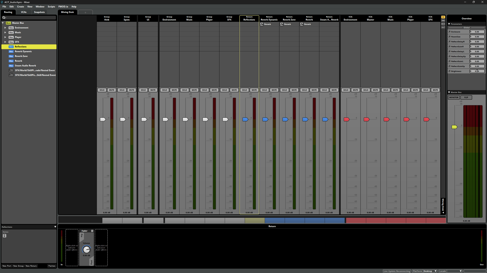
3. **Sends at −∞.** The groups did send to `Reverb Dynamic`, but every send knob sat at −∞ dB, so no signal reached any reverb. **This was the main reason the conditions sounded identical.** 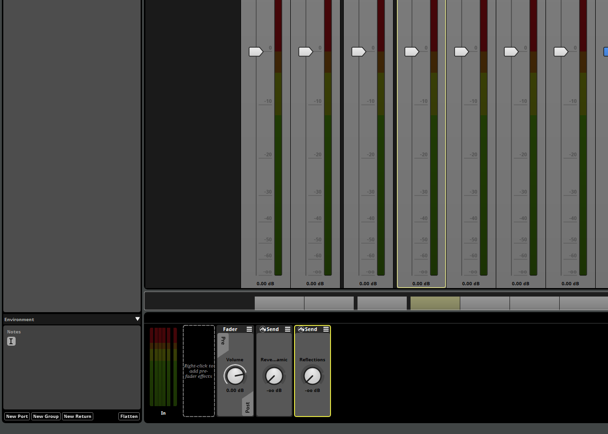

**Breakthrough.** After rebuilding the `RoomSize` automation, setting `Enclosure` to drive the return's volume, and raising the sends, the dynamic reverb responded to the room. 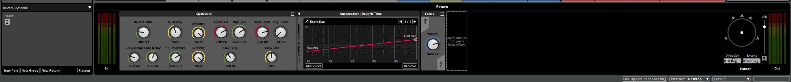

**Roadblock → plan change (8 Oct).** The proposal planned the early-reflection taps (left, right, up) as one `Reflections` bus. FMOD's Delay effect has one delay time and no per-channel delays, so one return can't hold three taps, and stacked delays run in series and add up. 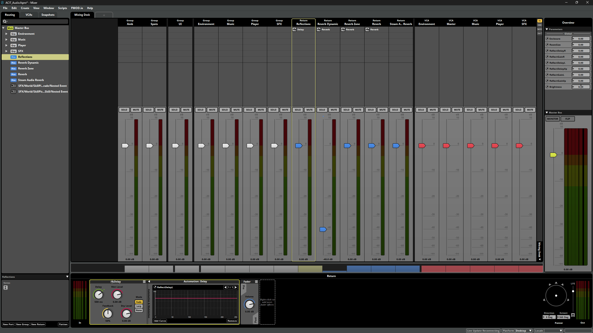

**Breakthrough.** I split them into three returns, **Reflect L**, **Reflect R** and **Reflect UP**. Each has:
- a Delay with Dry Level at −∞ and Feedback at 0%;
- delay time automated by `ReflectDelay*` (0–250 ms);
- Wet Level automated by `ReflectGain*` (0–1).

The three returns sit inside a group named `Reflections`, so `ConditionManager` can still mute them all through one path, `bus:/Reflections`. One mistake I caught: my first delay curve ended at 5 s instead of 250 ms. 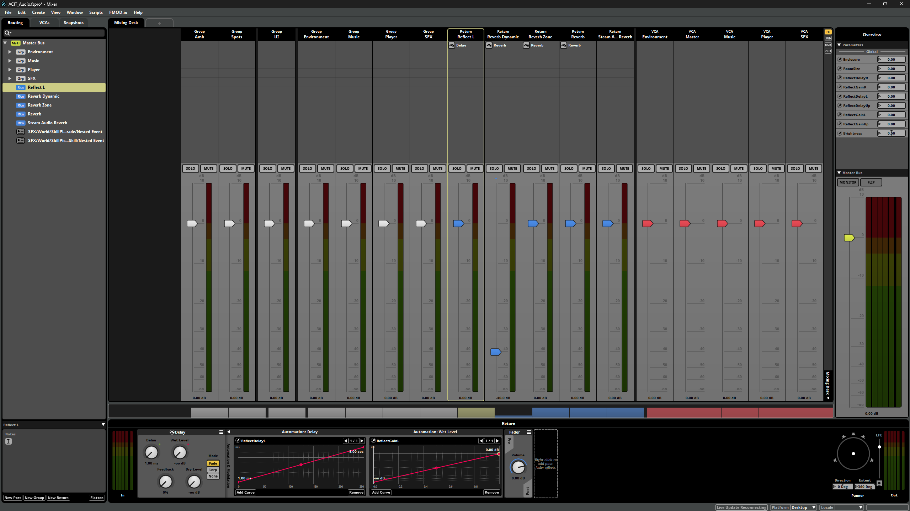 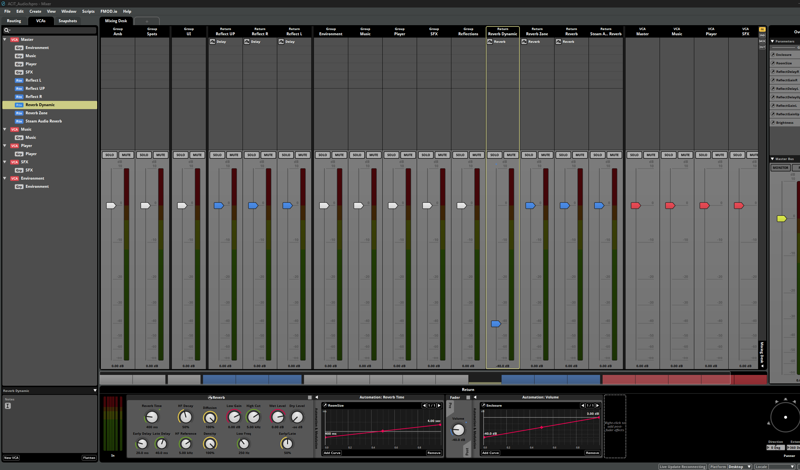

**Roadblock (8 Oct).** Jump, landing, footstep and time-switch sounds stayed behind when the player moved. `PlayerAudio` set each instance's 3D position once, at the start. **Fix:** attach each instance to the player with `RuntimeManager.AttachInstanceToGameObject`. The crush sound was left detached on purpose so it keeps playing through the respawn.

**Also fixed:** the `EarlyReflections2D` surface layers (only `Solid`) didn't match the probe's layers, so walls on the era layers gave reverb but no echoes. 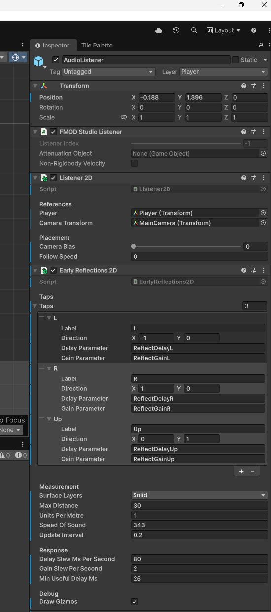

**AI use.** Claude reviewed my scripts and FMOD screenshots and suggested the causes and fixes above. I made every change in Unity and FMOD Studio and tested them myself.

---

## Week 10 (12 – 18 Oct): spatialising reflections, debugging the live pipeline

**Roadblock (12 Oct).** `Listener2D`'s Player field pointed at the listener object itself, so the listener followed itself. It only worked because the object happened to be parented to the player. I re-pointed it at the player. 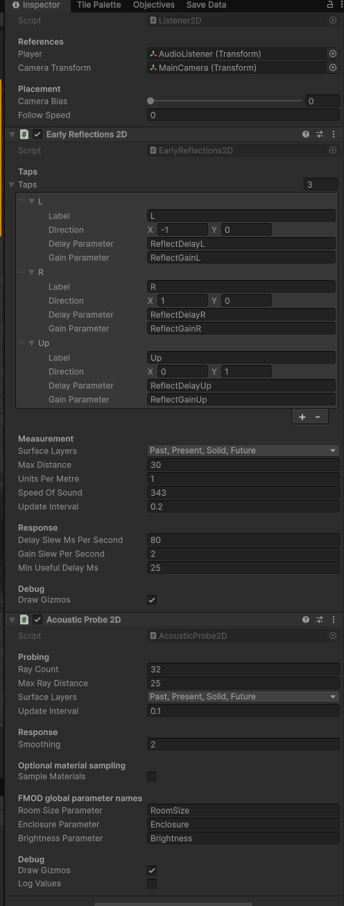

**Roadblock (12 Oct).** A beam fired at my feet echoed only in the left ear, never from the right. The cause: each reflect return held a delayed copy that kept the original sound's pan position, so an echo off the right wall still arrived on the left.

**Breakthrough.** I panned each return towards its wall with a narrow spread:
- Reflect L: −90°, extent 40°;
- Reflect R: +90°, extent 40°;
- Reflect UP: 0°, extent 60°.

Each echo now comes from the side of the wall that produced it.

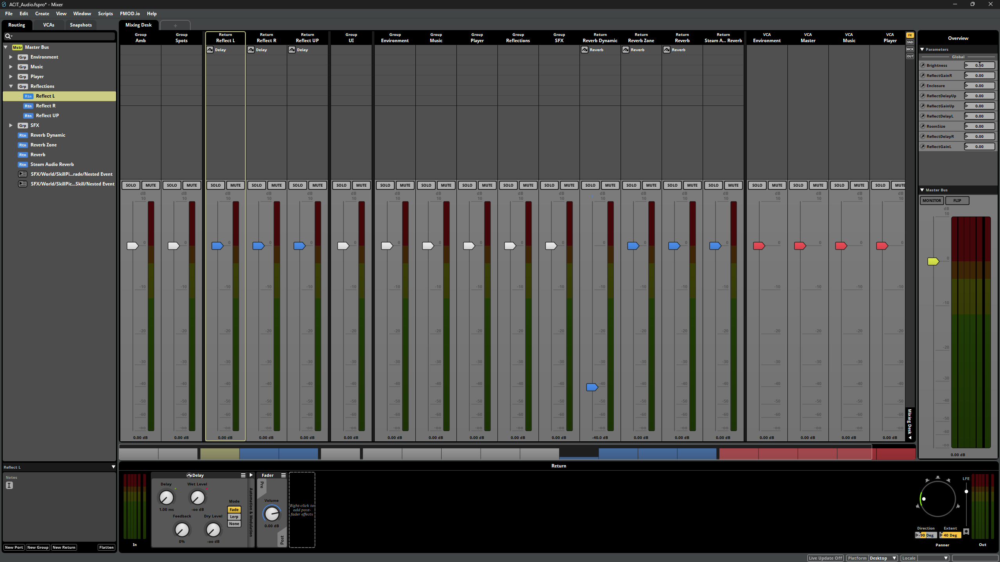  

**Roadblock (12 Oct).** My test-click script threw `InvalidOperationException`. The project uses the Input System package, so the old `Input.GetKeyDown` API isn't available. I rewrote it with `Keyboard.current`. This also showed that `ConditionManager`'s hotkeys (7/8/9) have the same problem, so for testing I switched conditions through the Inspector instead. `[TO CONFIRM whether ConditionManager / RoomEstimationTask / AudioBenchmarkLogger were updated]`

**Roadblock (12 Oct).** FMOD Live Update wouldn't connect: "port 9264 is currently in use". I moved it to port 9265 in both the Unity FMOD settings and FMOD Studio (`localhost:9265`), and the connection worked. 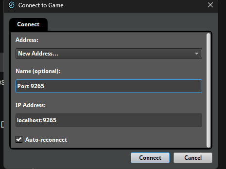

**Roadblock (12 Oct).** With Live Update connected, every acoustic parameter read 0.00 in FMOD. I confirmed all nine global parameters were set up correctly: all Global, delays 0–250, gains and room values 0–1, each automating a bus. I then turned on the probe's logging, which showed sensible readings (`size 0.15, enclosure 0.97`, a small enclosed room). That pointed the problem away from FMOD and towards the condition and banks state. 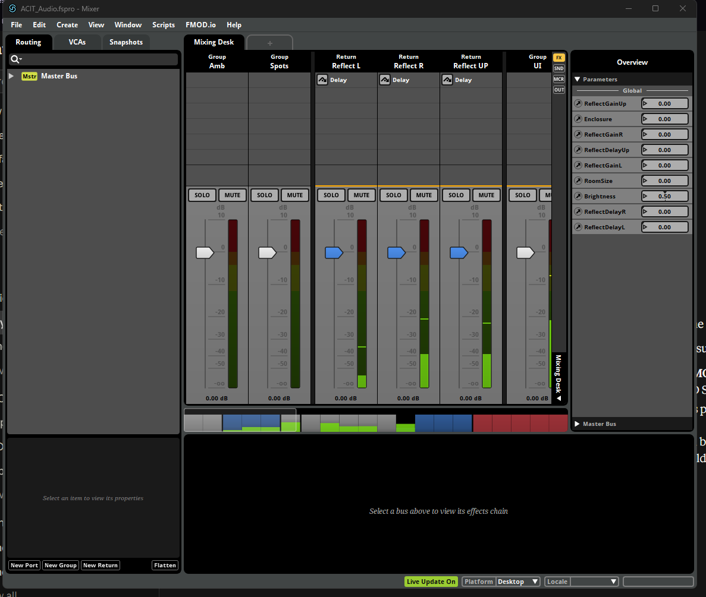 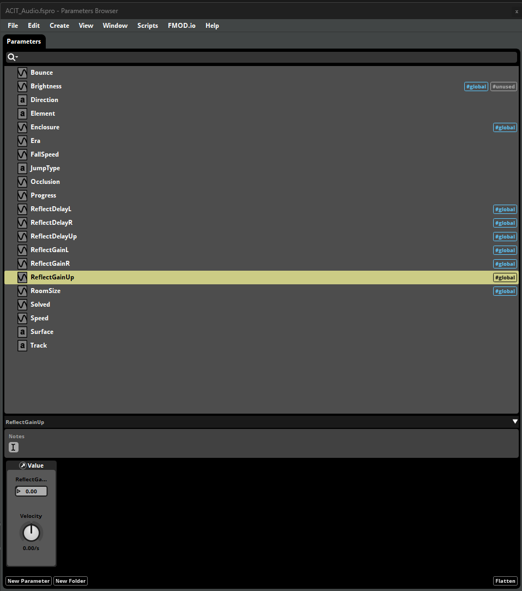 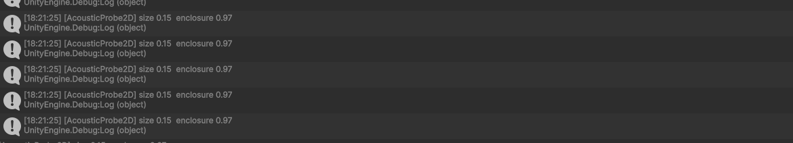

**Breakthrough (12 Oct).** No echoes in small rooms turned out to be a threshold, not a fault. `EarlyReflections2D` silenced any tap under 25 ms, which is about 4.3 m to the wall and back, so every wall in a small room was muted. Lowering **Min Useful Delay** to 6 ms brought them back. Echoes under about 25 ms read as colouration rather than a separate repeat, which is a tuning trade-off to revisit in the demo scenes. 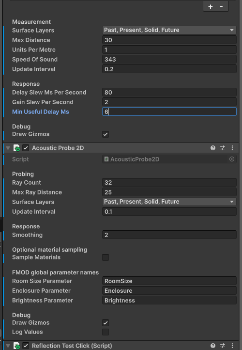

**Roadblock that was actually correct behaviour (12 Oct).** Only Reflect L and Reflect UP moved on the meters. I was about 8 units from a wall on my left, with nothing within 30 units on my right, so the right tap correctly stayed silent: no surface means no reflection.

**Decision point (18 Oct).** Condition C (Steam Audio) still doesn't sound convincing in the game level, despite the proxy mesh. Rather than drop it straight away, I'll build a purpose-made test scene of simple closed rooms, where the proxy geometry is clean, and give Steam Audio a fixed time budget there. If it works, all three conditions are compared in the same rooms, which keeps the research question as proposed. If it doesn't, the study runs on Conditions A and B, and the time spent on Steam Audio becomes evidence for the "lower implementation cost" part of the research question. `[TO CONFIRM outcome]`

**Milestone (18 Oct).** Development of the acoustic system is complete. Started on the final deliverables: this diary, a showcase repo split out from the main game repo, and the report.

**AI use.** Claude helped diagnose each roadblock from screenshots and console output, and drafted this diary from my session history, screenshots and notes. I checked and edited it.

---

## Week 11 (19 – 25 Oct): planned

- [ ] Showcase repo: split the audio work out of the main game repo (keeping its history where possible), add the FMOD Studio project, and leave out team and third-party content.
- [ ] Test scene: an "acoustics gallery" of 3–4 closed rooms of known size (small room about 4×4, corridor about 3×20, medium room about 10×8, large hall about 25×15, plus an optional open area), with the same test emitter in each. It serves all three conditions, gives the room-estimation task its ground truth, and doubles as the video set.
- [ ] Steam Audio, time-boxed in the test scene: check listener and emitters at z = 0 inside the proxy, caps on, re-export after every geometry change, Apply Reverb on the Steam Audio Listener, sends to `Steam Audio Reverb` raised from −∞.
- [ ] Run the user study. `[TO CONFIRM: participants, conditions, instruments]`

*Write up what actually happened here at the end of the week.*

## Week 12 (26 Oct – 1 Nov): planned

- [ ] Collate and analyse the study data; capture CPU and memory benchmarks for each condition.
- [ ] Record the portfolio video and upload it to Echo360. Don't put the video in the repo.

## Week 13 (2 – 8 Nov): planned

- [ ] Final report, with the Statement on Generative AI use and its evidence.

---

## Plan vs actual (against the research proposal)

| Proposal deliverable | Status | Change and reason |
|---|---|---|
| Unity + FMOD project with three conditions | B complete; A `[TO CONFIRM]`; C built but under review | Reflections bus split into three panned returns (Weeks 9–10); dedicated test scene added (Week 11); Steam Audio kept only if it works there |
| 3-minute portfolio video | Not started | — |
| Technical implementation guide (2,500–3,000 words) | Draft build guide exists `[TO CONFIRM]` | — |
| Importable Unity package (LG5) | `[TO CONFIRM]` | — |
| Study with 10 participants + benchmarking | Not started | Possibly two conditions instead of three |
| Development diary | This document | — |
| Evaluation and reflection reports | Folded into the Final Project Report template | Template change |
