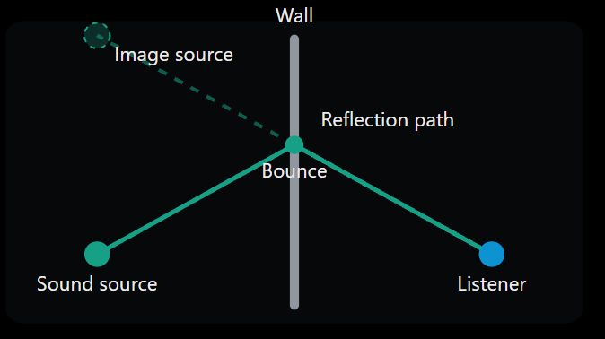

# Implementation guide: room acoustics for 2D tilemap games

This guide is for audio designers and audio programmers who want rooms in a 2D Unity game to sound like the spaces they look like. It rebuilds the system from this project step by step, using FMOD Studio and Unity. By the end you will have:

- **Condition B, raycast dynamic:** reverb and early reflections measured from the level as the player moves, plus echoes for sounds made across the room. This is the main system. It needs no meshes and no third-party plugins.
- **Condition A, zone baseline** *(optional)*: hand-placed reverb zones, the usual approach and the one to compare against.
- **Condition C, Steam Audio** *(optional)*: geometry-based simulation on a mesh generated from your tilemap, as a reference.

The fastest start is the release package (`ReflectiveAudio2D.unitypackage`) and the template FMOD project). Section 4 explains every part of it, so you can also wire it into your own game by hand.

**Time.** Condition B takes about 2 to 3 hours from an empty FMOD project, or under an hour from the template. Add about an hour for Condition A, and half a day for Condition C, most of it on Steam Audio setup.

---

## 1. Requirements

| | Version used | Notes |
|---|---|---|
| Unity | 6000.3.10f1 (6.3 LTS) | Any Unity 6 should work |
| FMOD Studio and FMOD for Unity | 2.03 | Both versions must match |
| Input System package | Current | The scripts also run under the old Input Manager |
| Steam Audio (Unity package and FMOD Studio plugin) | 4.8.1 | Condition C only, from Valve's Steam Audio releases on GitHub |

Your level needs a **Tilemap with a `TilemapCollider2D` merged into a `CompositeCollider2D`** (Composite Operation *Merge*, static `Rigidbody2D`), on its own layer. This guide calls that layer `Solid`. The rays, the echoes and the Steam Audio mesh all read that collider.

---

## 2. How the signal path works


### 2.1 Sends, return buses and Dry Level

A send in FMOD takes a copy of a sound and routes it to a return bus. The return bus processes that audio with effects such as reverb and mixes it back with the original sound.

The reverb effects have their Dry Level set to −∞ dB because the original sound is already playing through its normal path. The return then outputs only the processed reverb, so the original sound isn't doubled.

Return buses also let many sounds share the same reverb effects, instead of needing a separate effect for every sound.

### 2.2 Global parameters and automation

Global parameters let Unity control FMOD effects while the game is running.

In this project, a probe continuously casts rays to detect the surrounding surfaces. It uses them to update FMOD parameters several times a second, rather than only when the player enters a new room.

For example, the `RoomSize` parameter runs from 0 to 1. FMOD automation connects it to reverb settings, so the sound changes with the surrounding space. The reverb adjusts as the player moves between smaller and larger spaces, without a different reverb being triggered by hand for each room.

### 2.3 Echo delay and multiple taps

An echo occurs when sound reflects off a surface and takes longer to reach the listener than the direct sound.

The delay is the extra distance the reflected sound travels, divided by the speed of sound (about 343 metres per second):

```
delay = extra path length ÷ speed of sound
```

For example, if the reflected sound travels an extra 10 metres: 10 ÷ 343 = 0.02915 s, or about 29 ms after the direct sound.

Different surfaces produce echoes with different delays. Each separately timed reflection is called a tap.

A standard FMOD Delay effect can't time three taps independently, because it has only one delay interval per channel. Feedback can produce repeated echoes, but they follow that same interval. Three independently timed reflections need separate Delay effects in parallel, each with its own delay time. That is why this project uses three return buses: Reflect L, Reflect R and Reflect UP.

### 2.4 The image-source method

The image-source method calculates the direction and distance of a sound reflection.

It treats a wall like a mirror. An imaginary copy of the sound source is placed on the opposite side of the wall, at the same distance from it. A straight line from this imaginary source to the listener crosses the wall at the reflection point.



*The image-source method: the reflection travels from the source to the wall and on to the listener, and the mirrored source gives its length and direction.*

This gives the total distance the reflected sound travels, and the direction it reaches the listener from. Comparing the reflected distance with the direct distance gives the extra path length, and therefore the echo delay.

If a sound reflects off a wall to the player's right, for example, the reflection can be positioned so it sounds as though it comes from that direction. The reflections then stay consistent with the level's geometry.

---

## 3. FMOD Studio setup

Do this in the **Mixer** window (**Window → Mixer**). Names matter: the Unity scripts find buses by path and parameters by name.

### 3.1 Global parameters

Create these under **Preset Browser → New Parameter → Continuous**, each with **Global** ticked:

| Parameter | Range | Written by |
|---|---|---|
| `RoomSize` | 0–1 | `AcousticProbe2D` |
| `Enclosure` | 0–1 | `AcousticProbe2D` |
| `Brightness` | 0–1 | `AcousticProbe2D` (optional) |
| `ReflectDelayL`, `ReflectDelayR`, `ReflectDelayUp` | 0–250 | `EarlyReflections2D` (milliseconds) |
| `ReflectGainL`, `ReflectGainR`, `ReflectGainUp` | 0–1 | `EarlyReflections2D` |

### 3.2 The dynamic reverb (Condition B)

1. Create a return bus called **Reverb Dynamic** at the top level of the mixer.
2. Add an **FMOD Reverb** effect and set **Dry Level to −∞**. A return should only add reverb; at 0 dB it passes a second copy of the dry sound.
3. Right-click **Reverb Time** → **Add Automation**, choose `RoomSize`, and draw a curve from about **0.4 s at 0 to 4 s at 1**. Late Delay (about 20 → 60 ms) and High Cut (about 8 → 4 kHz) work well on the same parameter, so big rooms ring longer and duller.
4. Automate the return's **fader volume** with `Enclosure`, from about **−40 dB at 0 to 0 dB at 1**. Open spaces then get almost no reverb.

### 3.3 The early reflections (Condition B)

FMOD's **Delay** effect has one delay time and no per-channel delays. Three wall reflections (left, right and above) therefore need three returns.

1. Create a **group** called **Reflections**, and inside it three return buses: **Reflect L**, **Reflect R** and **Reflect UP**. The group gives Unity one path, `bus:/Reflections`, to mute all three at once.
2. On each return, add a **Delay** effect with **Feedback 0%** and **Dry Level −∞**.
3. Automate its **Delay** time with the matching `ReflectDelay*` parameter (0–250 ms), and its **Wet Level** with the matching `ReflectGain*` (−∞ at 0 up to 0 dB at 1). Check the delay curve ends at 250 ms, not 5 s.
4. **Pan each return towards its wall**, otherwise a reflection keeps the original sound's position and an echo off the right wall arrives on the left. In the return's panner:
   - Reflect L: **−90°, 40° extent**;
   - Reflect R: **+90°, 40° extent**;
   - Reflect UP: **0°, 60° extent**.

   Keep L and R the same width, or one side will sound different from the other.

### 3.4 Sends from your sounds

The returns only hear what is sent to them.

1. On each group that should sound like the room (player, SFX, environment), add a **send** to Reverb Dynamic, Reflect L, Reflect R and Reflect UP, plus Reverb Zone and Steam Audio Reverb if you build those conditions.
2. **Raise every send from −∞.** New sends start silent. This was the main reason all three conditions first sounded identical in this project.
3. Sounds made away from the player, such as a projectile hitting a far wall, get their echoes from `ImageSourceEchoes2D` (section 4.5). Put them in their own group, here **WorldSFX**, with the reverb sends but **no Reflect sends**. Otherwise they echo twice.

### 3.5 Zones (Condition A, optional)

1. Create a return bus called **Reverb Zone** with an FMOD Reverb (Dry Level −∞) and its fader at **−∞**.
2. For each kind of room, create an **overriding snapshot** (here `Zone_SmallRoom`, `Zone_Corridor`, `Zone_MediumRoom` and `Zone_LargeHall`). Scope it to the Reverb Zone fader and reverb settings, raise the fader (for example to −6 dB), and set a reverb time that suits the room.
3. Outdoors needs no snapshot: with every zone snapshot off, the fader returns to −∞ and the sound is dry.

### 3.6 Steam Audio return (Condition C, optional)

Install Steam Audio's FMOD Studio plugin, create a return bus called **Steam Audio Reverb**, and add the **Steam Audio Reverb** effect. For a fair comparison with A and B, leave **Apply HRTF** off, so the reverb is panned by FMOD like the other conditions.

### 3.7 Build

Press **F7** to build the banks, and make sure FMOD for Unity points at this project (**FMOD → Edit Settings**). If **Live Update** reports that port 9264 is in use, change it to another port, such as 9265, in both FMOD Studio and the Unity FMOD settings.

---

## 4. Unity setup

### 4.1 Import

1. Install FMOD for Unity 2.03 and the Input System, and link your FMOD project.
2. Import `ReflectiveAudio2D.unitypackage` (**Assets → Import Package → Custom Package**). The Console should show no errors.
3. Quick check: **Tools → Reflective Audio 2D → Create Demo Scene** builds five test rooms, a stand-in player and the listener rig. It also adds the `Solid` and `Player` layers if they are missing. Set the player's **Impact Event**, press Play and click a wall.

### 4.2 Layers and the player

- Walls go on `Solid`, and the player is tagged **`Player`**. `AcousticZone2D` and the room builder look for that tag.
- In **Project Settings → Physics 2D → Layer Collision Matrix**, make sure the player's layer collides with `Solid`.
- Don't flip the sprite with `localScale.x` if the listener is a child of the player: that also flips the listener's left and right. Flip the `SpriteRenderer` instead.

### 4.3 The listener rig

Add a child object to the player, called **Listener**, with these components:

| Component | Set |
|---|---|
| **Studio Listener** | Nothing (it is FMOD's listener) |
| **Listener 2D** | **Player:** the player's transform. **Ear Offset:** from the player's pivot to ear height, for example (0, 1.5) if the pivot is at the feet. **Camera Bias:** 0 to listen from the player, up to 1 to listen from the camera |
| **Acoustic Probe 2D** | **Surface Layers:** `Solid`. **Ray Count:** 16 by default. **Update Interval:** 0.1 s |
| **Early Reflections 2D** | **Surface Layers:** `Solid`. **Min Useful Delay:** 6 ms (see below) |
| **Image Source Echoes 2D** | **Wall Layers:** `Solid`. **Reflectivity:** 0.7 to start |

The ear offset matters more than it looks. With the listener at the feet, the rays graze the floor and the echo calculation finds the floor or ceiling instead of the side walls.

**Min Useful Delay** drops reflections whose round trip is too short to hear as an echo. The original 25 ms (about 4.3 m to the wall and back) muted every wall in a small room. At 6 ms, small rooms get a tight slap. Reflections under about 25 ms are heard as colour, not as a separate echo, so this setting is a matter of taste.

### 4.4 Condition Manager

Add one **Condition Manager** to the scene:

- **Probe** and **Reflections:** the components from 4.3. They are switched off outside Condition B, which also saves their CPU.
- **Steam Audio Objects:** any objects used only by Condition C.
- **Bus paths:** check that they match your mixer (`bus:/Reverb Zone`, `bus:/Reverb Dynamic`, `bus:/Reflections`, `bus:/Steam Audio Reverb`).
- **Starting Condition:** set to B for a game that ships with the raycast system only.
- **Keys:** 7, 8 and 9 switch between A, B and C while playing, and the cycle key steps through them. These are for testing only, so hide them from players.

### 4.5 Echoes for sounds made away from the player

`EarlyReflections2D` measures walls from the listener, which suits footsteps and jumps. For a sound made somewhere else, play it as usual and then ask for its echoes:

```csharp
RuntimeManager.PlayOneShot(impactEvent, hitPoint);
ReflectiveAudio2D.ImageSourceEchoes2D.Emit(impactEvent, hitPoint);
```

For each nearby wall, the source is mirrored in the wall. The echo is delayed by `(|image − ear| − |source − ear|) / 343` seconds, and its gain is `reflectivity × direct ÷ reflected`. Bigger rooms give later, quieter echoes. Echoes under 10 ms or over 250 ms are skipped, as is any bounce point in a doorway. Turn on **Log Echoes** to get one Console line per impact, explaining each wall's echo or why it was skipped. **Draw Paths** shows the reflection paths in the Scene view.

### 4.6 Zones (Condition A)

Add a trigger `BoxCollider2D` with **Acoustic Zone 2D** to each room, and pick that room's snapshot. Let neighbouring zones overlap by a wall's thickness in each doorway, so the snapshots blend there instead of dropping out. `AcousticsGalleryBuilder` does this automatically for its test rooms.

### 4.7 Steam Audio (Condition C)

1. Install Steam Audio 4.8.1. Set **Audio Engine** to *FMOD Studio* in the Steam Audio settings.
2. Add **Tilemap Acoustic Proxy** to the tilemap, then right-click it → **Build Acoustic Mesh**. This extrudes the composite collider into a closed 3D mesh with floor and ceiling. Steam Audio's Geometry component needs a Mesh Filter or Terrain, and a Tilemap has neither, which is why it couldn't read the level directly.
3. Add **Steam Audio Geometry** to the generated mesh, give it a material (Concrete in this project), and export the scene. Re-export after every geometry change.
4. Add a **Steam Audio Listener** with **Apply Reverb** on, and add the Steam Audio objects to the Condition Manager's list.
5. If FMOD fails at start with `Loading plugin 'phonon_fmod'… ERR_FILE_NOTFOUND`, FMOD for Unity is installed as a package and can't see plugins under `Assets/`. Create **Assets → Create → Reflective Audio 2D → Steam Audio FMOD Plugin Loader**, set it as **FMOD → Edit Settings → Callback Handler**, and remove `phonon_fmod` from the Dynamic Plugins list.

Settings used in this project: 4,096 real-time rays, 16 bounces, 3 s duration, ambisonic order 1, up to 32 sources, 5% of CPU cores, a 0.1 s update interval and convolution reflections.

---

## 5. Testing and tuning

- **Build a test scene of known rooms.** Add **Acoustics Gallery Builder** to a tilemap, assign a wall tile and right-click → **Build Rooms**. It draws five rooms with exact sizes, plus zones and listening spots. Judge every condition in the same rooms.
- **Watch the meters with Live Update.** Walk from the small room into the hall: `RoomSize` and `Enclosure` should climb, and the Reflect returns should light up only on the sides that have a wall within 30 units. A silent right tap with no wall on the right is correct.
- **Turn on logging.** **Log Values** on the probe prints what it measures; a small enclosed room reads something like "size 0.15, enclosure 0.97". **Log Echoes** explains every impact.
- **Match loudness** before comparing conditions. Set the return faders so each condition sounds about equally loud in the same room. Otherwise the loudest one tends to win a listening test.
- **Measure cost.** **Audio Benchmark Logger** writes FMOD CPU, memory and frame rate to a CSV, tagged with the active condition. Make sure sound is playing while it logs (a looping emitter, or shots fired): a run with `channels_playing` at 0 only measures idle cost. In this project, FMOD's CPU use stayed under 1% of one core in every condition (Steam Audio's own simulation threads aren't included in that figure).

---

## 6. Troubleshooting

| Symptom | Cause and fix |
|---|---|
| All conditions sound the same | Sends left at −∞ (3.4); two listener rigs overwriting the same parameters (keep one); or a return's reverb settings not automated |
| An echo comes from the wrong side | The Reflect returns aren't panned (3.3) |
| No echoes in small rooms | Min Useful Delay too high (4.3) |
| `InvalidOperationException` from input calls | The project uses the Input System only. Use `KeyInput.Down` and `KeyInput.Held` instead of `Input.GetKeyDown` |
| Global parameters stay at 0 in FMOD | Check the probe's log first. If the values there are sensible, the condition is probably not B, or the banks are out of date |
| Live Update won't connect | The port is in use, so change it in both FMOD Studio and Unity (3.7) |
| FMOD error `ERR_FILE_NOTFOUND` for `phonon_fmod` | Use the plugin loader (4.7) |
| Echoes find the ceiling instead of the walls | The listener is at the player's feet, so set Ear Offset (4.3) |
| Beam sounds echo twice | They also go to the Reflect returns, so move them to a group without Reflect sends (3.4) |
| Left and right swap when the player turns | The sprite is flipped with `localScale.x` (4.2) |
| The player falls through the demo walls | Player and `Solid` don't collide in the Layer Collision Matrix (4.2) |

---

## 7. Limitations

- **One FMOD project.** The mixer lives in the Master bank, and banks from two FMOD projects can't be combined. Start from the template project, or rebuild sections 3.1–3.6 in your own.
- Walls are assumed to be axis-aligned, as on a tilemap, and echoes are first-order (one bounce per wall).
- Echoes are timed by a coroutine, so they can land up to one frame late (about 8 ms on average at 60 fps).
- Reflection strength doesn't yet depend on the wall's material, and nothing models sound bending around corners.

## Credits

FMOD Studio by Firelight Technologies; Steam Audio by Valve; Unity by Unity Technologies. The image-source method follows Allen and Berkley (1979), "Image method for efficiently simulating small-room acoustics", *Journal of the Acoustical Society of America* 65(4).
